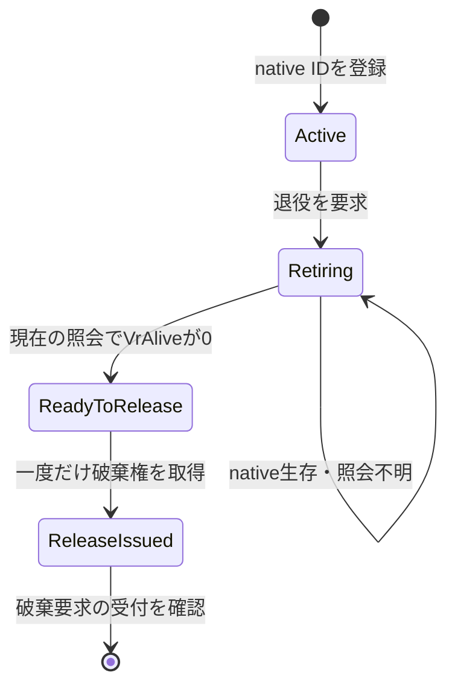

# GPU targetの世代と退役条件

2026-11-08 UTC。Unityなしで検証できる状態処理を`GpuRetirementLedger`として実装した。**既存Probe/Pumpへの接続はまだ行っていない。** 現在のTexture破棄・render event・Java/native実装の動作を変更した成果ではない。実EditorとQuestの確認は別に必要。

## 現在の根拠

- `GpuWebViewProbe.Close`と`ActivityGpuWebViewProbe.Close`はJavaへcloseを要求し、targetをVulkanProbePumpへ渡す。Java側の処理はUI threadへpostされるため、close呼出しから戻っただけではproducer停止を保証しない。
- JavaのHost/Session.closeはproducer/View/Surfaceを閉じ、`nativeStop`を通知する。作成途中の失敗では`VrAbandon`を使う経路もある。
- `GpuProbe.cpp`のnative sessionは、stoppingかつin-flight frameが空になるまで残る。native render callbackは停止中もcollectを継続する。
- `VulkanProbePump.Update`はrender eventをsubmitした後に`VrAlive(id)`を調べ、0の場合だけ退役TextureへDestroyを要求する。

このため、C#のClose、Javaへの要求、render eventのsubmit、native側の解放、UnityオブジェクトのDestroyは異なる出来事。アプリfocusやIME終了もGPU完了の証拠ではない。

## 今回の状態処理

Unity依存のないinternalクラスを既存の検証assemblyに追加した。Coreの製品APIへ昇格させず、P/Invoke、JNI、Unity API、frame fenceやTexture参照は持たせていない。状態処理は直列に呼び出す前提で、スレッド安全性を提供しない。

| 操作 | 契約 |
|---|---|
| Register | VrCreate成功後の非0 IDだけを登録。追跡中の同じIDの上書きを拒否。IDに加え、不変のmanaged世代オブジェクトを発行する |
| RequestRetirement | ActiveからRetiringへ一度だけ移す。producer停止やGPU完了とは扱わない |
| RecordRenderEventSubmission | adapterが実際にrender eventをsubmitできた後に記録する。GPU完了の証拠ではない |
| BeginNativeCheck | 退役要求後に少なくとも一度submitされている世代だけを照会可能にする。世代と最新submitに結び付いた照会ticketを発行する |
| ObserveNativeAlive | 現在のticketの結果だけを一度受け取る。値0だけでReadyToReleaseへ進む。非0・未知値は保持し、古い/別ledger/再送ticketは拒否する |
| ClaimRelease | ReadyToReleaseに限り、一つのReleasePermitを発行する。まだ登録を消さない |
| ConfirmRelease | adapterが破棄要求の受付を確認してから呼ぶ。世代とpermitが一致したときだけ登録を消す |

ObserveNativeAliveのbool戻り値は「現在の返信を受け付けた」であり、破棄許可ではない。破棄許可はClaimReleaseだけから取得する。照会の例外を0へ変換しない。返答なし・エラーは保持のまま次のpump passで照会をやり直す。

UnityのDestroyは遅延するため、ConfirmReleaseは物理的なメモリー解放完了を意味しない。permit取得後に破棄要求が失敗・中断した場合はReleaseIssuedと元permitを保持する。自動で別permitを発行したり、timerで記録を捨てたりしない。未確認の破棄要求を自動再送してよいとは定めていない。

ConfirmRelease後のStateOfはUntrackedを返す。Untrackedは「そのledgerが所有していない」という意味だけで、任意のTextureを破棄してよいという許可ではない。解放後にnative IDが再利用されても、古い世代・照会・permitは新しい登録に一致しない。

## Editor確認後に接続する境界

1. native作成成功時に世代を発行し、`世代 -> RenderTexture`の対応を実体の所有者が保持する。作成失敗のID 0は登録しない。
2. producer停止を要求して退役対象を移す。古いcallbackは現在のtargetではなく、捕捉しておいた世代だけを参照する。
3. pumpがrender eventをsubmitし、成功後にRecordRenderEventSubmissionを呼ぶ。submit失敗時はそのpassの照会・破棄へ進まない。
4. RetiringGenerationsのsnapshotごとにticketを作り、そのticket.Target.NativeIdで実際のVrAliveを照会する。異なるIDの値を結び付けない。
5. permitが得られた世代のTextureだけにDestroyを要求し、受付後にConfirmReleaseする。現在表示中のTextureへ読み替えない。
6. pending世代はcomponentを閉じても保持する。Retiringが空であることだけを根拠に、active session用のrender pumpを止めない。

これは接続時の契約で、上記adapterを実装済みとは扱わない。state ledgerは渡された観測の出所やnative fenceを検証できない。現実のGPU完了を証明するのはnative実装と実際の照会であり、純C#テストでは代用できない。device shutdown、pump破棄やアプリ終了時にも、不明な資源を安全に解放できたという保証は追加しない。

## 検証した範囲

合成のnative応答で15シナリオを実行する。作成失敗、active保持、停止後の長いnative生存、submit順序、一度だけの破棄権、遅い/再送/置換ticket、未知のnative値、複数世代の順不同完了、重複close、ID再利用、別ledger混入、中断した破棄要求、snapshotの独立性を確認する。

既存MonoBehaviour・pump・Java/native・AAR/.soは変更していない。Editor import/compile、実VrAlive、Vulkan/GLES fence、HMDの描画・IME・レイの試験は行っていない。追加の実機操作依頼でもない。
