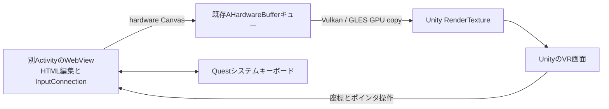

# AG1: 別ActivityからUnityテクスチャへ

HC1で確認した「別ActivityのWebView・システムキーボード・Unity VR画面の同時表示」と「リセット同期による復帰後のレイ表示」を、GPU転送へつなぐ検証です。HC1と元のGPU XRプローブは残しています。AG1では利用者がVulkan描画とIME起動を確認しました。Unityのレイ操作はまだ成立しておらず、preview.15（AG2）でフォーカス取得とタッチWindowの比較を追加しています。

## AG3: カメラ中央＋ピンチで座標を切り分ける

AG2の実機ログでは、textureはOpenXR FOCUSED=5とRightHandJoints tracked=trueへ戻りましたが、UnityRayのタッチ転送はありませんでした。利用者が見た白いレイはQuest側のもので、マゼンタの関節レイが視野外・別方向にある可能性をまだ排除できません。passthroughはVISIBLE=4とWindow focus=falseが継続し、この試行では入力可能な状態に戻りませんでした。NOT_TOUCHABLEによってQuestの3Dパネルを除去できたとは扱いません。

preview.16はWindowフラグを追加変更せず、通常のtextureと同じWindow条件で、カメラ中央＋明示的なピンチを試すheadモードを追加します。

```bash
bash Tools/run_activity_gpu_probe.sh head
```

**頭を動かしてUnity画面内の対象へ中央のマゼンタの点を合わせ、ピンチして離します。** 頭を向けて待つだけでは選択しません。手はHMDから見える位置に置き、通常と同じフォーカス・手追跡・鮮度・ジェスチャーの条件を満たす必要があります。

中央方向はCameraのTransformをそのまま仮定せず、XRDisplaySubsystemのrender passから得た左右のview matrixで計算します。これにより、肩から指先へ向ける関節レイの座標・方向と切り離して、UnityのポインターをWebViewへ送れるかを確認します。

Unityレイの先端には、脈動するマゼンタの球を追加しています。headモードでは画面中央付近、textureでは関節レイの先端です。白いQuestポインターとは別に、この点が見えるかを確認してください。目印はUnityの描画順を後ろへ回してCanvasに埋もれにくくしていますが、Questシステムのレイヤーを上書きする実装ではありません。

headのブラウズ中はネイティブ下部ボタンを無効表示にして、同じピンチでネイティブ側の別操作まで起こることを防ぎます。Window自体は通常通りtouchable/focusableです。編集へ入るとネイティブボタンを有効にし、Browseで戻れます。元ページをONにした場合もネイティブ操作を戻します。120秒の自動終了は維持します。

ログに `rayMode`、`hit`、`endViewport`、pinchのDown/Up/Cancelを追加しました。endViewportのx/yが0〜1、zが正なら左眼の視野内です。目印が見えない場合は、この投影値と実際の表示を照合します。数字の転記は不要です。

結果は次の3点を送ってください。

- 別Activityが表示されている間も、脈動するマゼンタの点が見えるか。
- 頭でPlay/PauseやUnity側のボタンを狙い、ピンチで選択できるか。
- 入力欄選択・IME・Browseからの復帰ができるか。

このモードは座標・描画・タッチ転送を分ける検証用です。製品の手レイを頭向きへ置き換える設計判断ではありません。

## AG2への更新と今回の比較

初回ログでは `app=False,XR=unknown` と `pointer=none tracked=False blocked=True` が続き、Unityの `XRDisplaySubsystem.displayFocusChanged` は通知されませんでした。一方、Meta XR FeatureにはOpenXRの4→5が出ています。下部の操作はネイティブのSource/Edit/Browseによるもので、UnityRayの転送記録はありません。透明な見た目でも、Android Windowの入力領域は前面に残っていました。

更新後、**既存AG1シーンを再ビルドする前に VRWebView > Activity GPU > Enable OpenXR Focus Probe** を実行してください。新しくCreate Activity GPU Probe Sceneを使う場合は自動で有効にします。AndroidのOpenXR設定へ観測専用Featureを追加し、ネイティブのOnSessionStateChangeからFOCUSED=5を取得します。Meta SDKやloaderの置換、拡張の追加要求、IgnoreFocus設定の変更は行いません。Featureが無効なままAG1シーンをビルドすると、原因を示して停止します。

まず `texture` を起動し、**マゼンタ色のUnityレイ**が出るかを確認します。ログでは `focusSource=OpenXRSession,xrState=5`、`pointer=RightHandJoints/LeftHandJoints`、操作時は `pointer source=UnityRay` が確認対象です。Quest側のネイティブポインターとは区別してください。

次に透明なWindowへの当たり方を比較します。

```bash
bash Tools/run_activity_gpu_probe.sh passthrough
```

このモードは元ページのWindow drawをOFFにし、ブラウズ中だけ同じアプリ内のホストWindowへFLAG_NOT_TOUCHABLEを設定します。WindowのfocusabilityとIME所有者は変更しません。UnityからWebViewへ直接送るポインター操作は残します。ネイティブの下部ボタンはブラウズ中は無効表示になります。Unity側のマゼンタレイで操作してください。

入力欄を選ぶとネイティブタッチを戻し、編集後はネイティブのBrowseでブラウズへ戻します。元ページをONにした場合もネイティブタッチを戻します。復旧には120秒の自動終了、または `native` モードでの再起動を使えます。Questの3Dパネルのポインター表示まで消えるか、Unityのレイ操作とIMEが両立するかは実機確認が必要です。

## 所有関係



Android ActivityがWebView・Surfaceのproducer・IMEを所有し、UnityがRenderTextureとconsumerを所有します。GPU転送・キュー上限・fence待ち・遅延解放は既存NDKコードを再利用します。CPU readbackはありません。Java側がproducerを停止してnativeStopを通知した後、Unityの既存render pumpが安全なタイミングで世代とテクスチャを解放します。

ページは既存の固定ローカル合成動画・HTMLのみです。外部遷移、file/contentアクセス、Web権限、fullscreenは許可しません。入力文字はログへ保存せず、DOMから取得するのは「編集要素が選択中か」という真偽値と、固定の動画再生ボタンの座標だけです。外部EditTextとの全文同期や独自InputConnection中継は実装していません。

## 準備

1. Unityを閉じてパッチを適用します。Androidのビルド済みAARも含まれています。
2. Unity 6000.4.5f1で **VRWebView > Create Activity GPU Probe Scene** を実行します。新しいシーンを保存し、ビルド対象をこのシーンだけにします。
3. 現在のGameActivity・OpenXR・Vulkan・ARM64を維持してBuild And Runします。Custom Main ManifestやInput Systemのfocus設定を変更する必要はありません。
4. 起動後、頭の追跡・XR displayのrunning・Unityのフォーカスが揃うと、GPU targetを作成して別Activityを起動します。

初回はVulkanで比較してください。GLESも同じproducerとGPUキューを使用しますが、この新しいActivity構成での実機検証は別途必要です。

## ログと固定試行（WSL）

ログ取得を先に開始します。保存先は `C:\Users\tmiyoshi\Downloads` です。

```bash
cd /mnt/c/source/Unity/SimpleUnity3DWebView
bash Tools/capture_activity_gpu_probe.sh
```

別の端末から試行を**1つずつ**実行します。各回はアプリを再起動します。

```bash
bash Tools/run_activity_gpu_probe.sh texture
```

| mode | 確認するもの | 起動時の動作 |
| --- | --- | --- |
| head | カメラ中央＋ピンチによる座標の切り分け | textureと同じWindow条件。自動選択なし、明示pinchのみ |
| texture | Unity内のテクスチャとUnityレイ操作 | 元WebViewのWindow drawはOFF。自動IME/再生はなし |
| passthrough | 透明な前面Windowのタッチを除いた比較 | 元ページOFF、ブラウズ中はネイティブタッチOFF。編集中は戻す |
| native | 元WebViewとUnityテクスチャの比較 | Window draw ON。まずネイティブ側の操作で確認できる |
| video | レイ入力と切り離した動画GPU転送・音声 | Window draw OFF。Windowフォーカス成立後に固定PlayボタンへAndroidのポインタ操作を自動送信 |
| ime | レイ入力と切り離した日本語IME・描画継続 | Window draw OFF。HTML入力欄へ自動focusし、編集接続とWindowが揃ったときに一度IME要求 |

HC1は20秒でしたが、**AG1は120秒で自動復帰**します。Unityが停止してもAndroid UI側で閉じます。途中で終了するにはネイティブの **Close host** を使います。まずtextureを確認し、レイが使えなければvideo/imeを独立して試してください。

ADB/出力先が異なる場合は既存と同じ `VRWEBVIEW_ADB_EXE`、`VRWEBVIEW_PACKAGE`、`VRWEBVIEW_LOG_DIR` を使用できます。公開の任意コマンド受信口は追加していません。起動modeは上記固定値だけです。

## 見えているページの区別

Unity側の画面には **AG1 UNITY TEXTURE**、GPUコピー数、回転キューブ、Unity側のReopen/Resize等のボタンがあります。この枠内の動画が動くかを確認してください。動画内に焼き込まれたフレーム番号が動くことが確認対象で、HTMLのDOMカウンターだけでは動画の転送成功としません。

別Activityの元ページはtexture/video/imeではWindow drawを抑制します。ただし、操作の復旧用にネイティブの下部ツールバーは表示します。

- **Source ON/OFF**：元ページのWindow drawを切替。描画比較用です。OFF時に、見えない元ページへネイティブのタップが入ることも防ぎます。
- **Edit field**：固定HTML入力欄へfocusしてIMEを要求。
- **Browse**：編集を終えてIMEを閉じ、HTML入力欄のfocusを外します。キーボードを閉じても入力欄が選択されたままなら、これでブラウズへ戻します。
- **Close host**：producerを終了し、Unityへ戻ります。

音声は元WebViewが再生します。テクスチャへ音声を取り込む実装ではありません。Close hostで音声も終了するかを確認してください。

## レイ入力の比較

別Activity中は、Unityの `Application.isFocused` がfalseのままでもXR表示が続くことをHC1で観察しました。同時にInput System側のMeta Aimが無効になるため、描画だけを接続してもUnityのレイが使えるとは限りません。

Unityにフォーカスがある場合は通常のcontroller/Meta Aimを優先します。別Activityの表示中は、次の条件が揃えばXR Handsの関節から作る別のレイを試します。この段階では、Unityがunfocusedの間のコントローラー入力は中継していません。

- XR displayがrunningで、**OpenXRのFOCUSED=5を観測済み**。観測用Featureを優先し、未観測・非FOCUSEDなら利用しません。displayFocusChangedはFeatureのinstanceが一度も作成されていない場合だけ補助として使い、破棄済みsessionを古いdisplay通知で復活させません。
- 今回のホストWindowが生存・resume・Window focus・レイアウト完了し、元ページのWindow drawがOFF。
- 編集要素が非選択で、IME Insetsも非表示。編集中・状態照会中はレイ操作を止めます。
- 手本体と必要な関節poseを取得でき、そのDynamic更新が250ms以内。

Input SystemのIgnoreFocus設定やSDKのdevice enable状態は変更しません。XRフォーカス・ホストの所有状態を無視して入力を取り続ける経路は追加していません。

この関節レイはMeta Aimと異なる幾何学的な検証用入力です。頭に対する肩の近似位置から親指・人差し指の中点へ向け、指先間距離25mm以下でpinch、40mm超でreleaseにします。手のひら/甲をHMDへ向けた姿勢は除外します。手を少し上げ、表示されるレイで狙ってください。Meta Aim相当の精度・ジェスチャー認識を保証するものではありません。`Use Owned Activity Joint Ray` をOFFにするとこの経路を止められます。

ログの `pointer=RightHandJoints/LeftHandJoints` は関節レイ、`RightHand/LeftHand` はMeta Aimです。Unityのレイはマゼンタで、Quest側のポインターとは別です。`XR=unknown` のままでレイが出なければ、focus通知の未取得を含む結果として記録してください。頭の向きだけによる自動選択はありません。フォーカス喪失時は押下をcancelし、再追跡時はピンチを離してから操作します。

編集中はUnityのレイを止め、Questのキーボードで操作します。編集終了後はネイティブツールバーのBrowseを選び、レイが戻るかを確認します。ホストを閉じてUnityへ戻る際は、HC1で効果を確認したXR Hands 1.7.3のリセット同期を適用します。

## 送ってほしい結果

1. texture：**Unityの枠内**にページが見えるか。レイの表示と、pinchによる再生/停止・スクロール・入力欄選択ができるか。
2. video：Unity枠内の動画フレーム番号が動くか、音声が聞こえるか。元ページの見た目と区別してください。
3. ime：キーボードが実際に見えるか、日本語変換・確定・途中挿入ができるか。その間、Unityのページとキューブが更新されるか。
4. Browse/Close host/120秒復帰後：レイ操作が戻るか。音声・Window・古い入力が残らないか。

ログの転記は不要です。Downloadsの `VRWebView-activity-gpu-日時.log` と観察結果を送ってください。`GPU copies`、nativeの`canvas`、Unityのframe/render数、Android UI側から見たheartbeatAge、XR focusと編集状態を照合します。数値の増加だけでHMDへの正しい動画提示やキーボード実表示を成功とは判定しません。

## 実装済みと未確認

実装：別Activityのproducerから既存AHardwareBufferへ描画、Vulkan/GLES consumer、世代別停止と遅延解放、固定入力経路、DOM編集中フラグ、限定した関節入力、120秒の独立タイマー、比較用起動/ログスクリプト。

実機確認待ち：Window draw抑制と別Activity IMEの両立、動画・音声・Unityテクスチャ、XR display focus通知、関節レイの操作性、編集からブラウズへの復帰、繰返し開閉・resize/background時の安定性。製品用のブラウザAPI・任意ページ・fullscreen/MSE/DRM対応ではありません。
