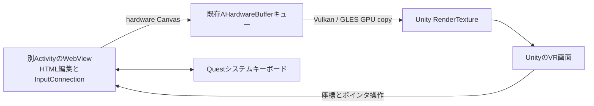

# AG1: 別ActivityからUnityテクスチャへ

HC1で確認した「別ActivityのWebView・システムキーボード・Unity VR画面の同時表示」と「リセット同期による復帰後のレイ表示」を、GPU転送へつなぐ検証です。HC1と元のGPU XRプローブは残しています。AG1のUnityコンパイル・Quest上の描画/入力/IMEの成立は確認待ちです。

## 所有関係



Android ActivityがWebView・Surfaceのproducer・IMEを所有し、UnityがRenderTextureとconsumerを所有します。GPU転送・キュー上限・fence待ち・遅延解放は既存NDKコードを再利用します。CPU readbackはありません。Java側がproducerを停止してnativeStopを通知した後、Unityの既存render pumpが安全なタイミングで世代とテクスチャを解放します。

ページは既存の固定ローカル合成動画・HTMLのみです。外部遷移、file/contentアクセス、Web権限、fullscreenは許可しません。入力文字はログへ保存せず、DOMから取得するのは「編集要素が選択中か」という真偽値と、固定の動画再生ボタンの座標だけです。外部EditTextとの全文同期や独自InputConnection中継は実装していません。

## 準備

1. Unityを閉じてパッチを適用します。Androidのビルド済みAARも含まれています。
2. Unity 6000.4.5f1で **VRWebView > Create Activity GPU Probe Scene** を実行します。新しいシーンを保存し、ビルド対象をこのシーンだけにします。
3. 現在のGameActivity・OpenXR・Vulkan・ARM64を維持してBuild And Runします。Custom Main ManifestやInput Systemのfocus設定を変更する必要はありません。
4. 起動後、頭の追跡・XR displayのrunning・Unityのフォーカスが揃うと、GPU targetを作成して別Activityを起動します。

初回はVulkanで比較してください。GLESも同じproducerとGPUキューを使用しますが、この新しいActivity構成での実機検証は別途必要です。

## ログと固定試行（WSL）

ログ取得を先に開始します。保存先は `C:\Users\tmiyoshi\Downloads` です。

```bash
cd /mnt/c/source/Unity/SimpleUnity3DWebView
bash Tools/capture_activity_gpu_probe.sh
```

別の端末から試行を**1つずつ**実行します。各回はアプリを再起動します。

```bash
bash Tools/run_activity_gpu_probe.sh texture
```

| mode | 確認するもの | 起動時の動作 |
| --- | --- | --- |
| texture | Unity内のテクスチャとUnityレイ操作 | 元WebViewのWindow drawはOFF。自動IME/再生はなし |
| native | 元WebViewとUnityテクスチャの比較 | Window draw ON。まずネイティブ側の操作で確認できる |
| video | レイ入力と切り離した動画GPU転送・音声 | Window draw OFF。Windowフォーカス成立後に固定PlayボタンへAndroidのポインタ操作を自動送信 |
| ime | レイ入力と切り離した日本語IME・描画継続 | Window draw OFF。HTML入力欄へ自動focusし、編集接続とWindowが揃ったときに一度IME要求 |

HC1は20秒でしたが、**AG1は120秒で自動復帰**します。Unityが停止してもAndroid UI側で閉じます。途中で終了するにはネイティブの **Close host** を使います。まずtextureを確認し、レイが使えなければvideo/imeを独立して試してください。

ADB/出力先が異なる場合は既存と同じ `VRWEBVIEW_ADB_EXE`、`VRWEBVIEW_PACKAGE`、`VRWEBVIEW_LOG_DIR` を使用できます。公開の任意コマンド受信口は追加していません。起動modeは上記固定値だけです。

## 見えているページの区別

Unity側の画面には **AG1 UNITY TEXTURE**、GPUコピー数、回転キューブ、Unity側のReopen/Resize等のボタンがあります。この枠内の動画が動くかを確認してください。動画内に焼き込まれたフレーム番号が動くことが確認対象で、HTMLのDOMカウンターだけでは動画の転送成功としません。

別Activityの元ページはtexture/video/imeではWindow drawを抑制します。ただし、操作の復旧用にネイティブの下部ツールバーは表示します。

- **Source ON/OFF**：元ページのWindow drawを切替。描画比較用です。OFF時に、見えない元ページへネイティブのタップが入ることも防ぎます。
- **Edit field**：固定HTML入力欄へfocusしてIMEを要求。
- **Browse**：編集を終えてIMEを閉じ、HTML入力欄のfocusを外します。キーボードを閉じても入力欄が選択されたままなら、これでブラウズへ戻します。
- **Close host**：producerを終了し、Unityへ戻ります。

音声は元WebViewが再生します。テクスチャへ音声を取り込む実装ではありません。Close hostで音声も終了するかを確認してください。

## レイ入力の比較

別Activity中は、Unityの `Application.isFocused` がfalseのままでもXR表示が続くことをHC1で観察しました。同時にInput System側のMeta Aimが無効になるため、描画だけを接続してもUnityのレイが使えるとは限りません。

Unityにフォーカスがある場合は通常のcontroller/Meta Aimを優先します。別Activityの表示中は、次の条件が揃えばXR Handsの関節から作る別のレイを試します。この段階では、Unityがunfocusedの間のコントローラー入力は中継していません。

- XR displayがrunningで、**displayFocusChangedでfocus=trueを観測済み**。未通知・falseなら利用しません。
- 今回のホストWindowが生存・resume・Window focus・レイアウト完了し、元ページのWindow drawがOFF。
- 編集要素が非選択で、IME Insetsも非表示。編集中・状態照会中はレイ操作を止めます。
- 手本体と必要な関節poseを取得でき、そのDynamic更新が250ms以内。

Input SystemのIgnoreFocus設定やSDKのdevice enable状態は変更しません。XRフォーカス・ホストの所有状態を無視して入力を取り続ける経路は追加していません。

この関節レイはMeta Aimと異なる幾何学的な検証用入力です。頭に対する肩の近似位置から親指・人差し指の中点へ向け、指先間距離25mm以下でpinch、40mm超でreleaseにします。手のひら/甲をHMDへ向けた姿勢は除外します。手を少し上げ、表示されるレイで狙ってください。Meta Aim相当の精度・ジェスチャー認識を保証するものではありません。`Use Owned Activity Joint Ray` をOFFにするとこの経路を止められます。

ログの `pointer=RightHandJoints/LeftHandJoints` は関節レイ、`RightHand/LeftHand` はMeta Aimです。`XR=unknown` のままでレイが出なければ、focus通知の未取得を含む結果として記録してください。頭の向きだけによる自動選択はありません。フォーカス喪失時は押下をcancelし、再追跡時はピンチを離してから操作します。

編集中はUnityのレイを止め、Questのキーボードで操作します。編集終了後はネイティブツールバーのBrowseを選び、レイが戻るかを確認します。ホストを閉じてUnityへ戻る際は、HC1で効果を確認したXR Hands 1.7.3のリセット同期を適用します。

## 送ってほしい結果

1. texture：**Unityの枠内**にページが見えるか。レイの表示と、pinchによる再生/停止・スクロール・入力欄選択ができるか。
2. video：Unity枠内の動画フレーム番号が動くか、音声が聞こえるか。元ページの見た目と区別してください。
3. ime：キーボードが実際に見えるか、日本語変換・確定・途中挿入ができるか。その間、Unityのページとキューブが更新されるか。
4. Browse/Close host/120秒復帰後：レイ操作が戻るか。音声・Window・古い入力が残らないか。

ログの転記は不要です。Downloadsの `VRWebView-activity-gpu-日時.log` と観察結果を送ってください。`GPU copies`、nativeの`canvas`、Unityのframe/render数、Android UI側から見たheartbeatAge、XR focusと編集状態を照合します。数値の増加だけでHMDへの正しい動画提示やキーボード実表示を成功とは判定しません。

## 実装済みと未確認

実装：別Activityのproducerから既存AHardwareBufferへ描画、Vulkan/GLES consumer、世代別停止と遅延解放、固定入力経路、DOM編集中フラグ、限定した関節入力、120秒の独立タイマー、比較用起動/ログスクリプト。

実機確認待ち：Window draw抑制と別Activity IMEの両立、動画・音声・Unityテクスチャ、XR display focus通知、関節レイの操作性、編集からブラウズへの復帰、繰返し開閉・resize/background時の安定性。製品用のブラウザAPI・任意ページ・fullscreen/MSE/DRM対応ではありません。
