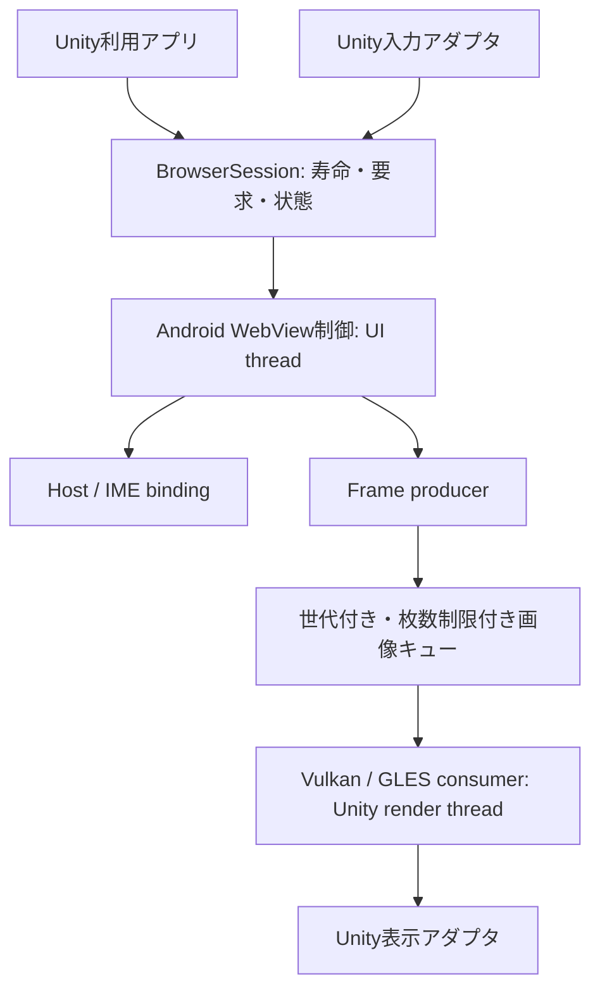

# 設計の見直し

2026-11-08 JST。[現在の状態](CurrentStatus.md)に基づく設計判断。以下の責務分離は目標であり、すべて実装済みのAPIではない。

## 製品の成立条件

QuestのVR空間で、Unityが通常のポインター操作を受け取り、動的Webページ・動画・音声を表示する。日本語の変換途中・確定・取消・文中挿入・選択置換を扱い、システムIMEを閉じた後にUnity操作へ戻る。Editor内ブラウザー、DRM、全動画方式、全サイトとの互換性を現時点で保証しない。

システムIME表示中の一時的な入力フォーカス喪失は許容する。描画継続と入力所有権は別の契約とする。

## 保つ境界

HostとIMEとproducerには制約上の結び付きがある。自由に組み替えられる汎用プラグイン基盤を先に作らず、成立した組み合わせをバックエンドとして公開する。

| 責務 | 現在 | 今後の契約 |
|---|---|---|
| Session | CoreのBrowserSession/IBrowserBackend。プローブ未接続 | 一つの寿命所有者。破棄後の遅延通知を世代で無効化 |
| ページ制御 | 各Java Probe/Activityに分散 | WebView作成・ナビゲーション・破棄をAndroid UI threadへ集約 |
| Hosting/IME | 同一Window、別Activity、VD等を比較中 | 対応するHostとIME接続を明示。GPU APIとは分離 |
| フレーム転送 | AHBキューとVulkan/GLES実装あり | 有界キュー、GPU完了まで画像保持、Unity render threadで資源操作 |
| ポインター | Core/uGUI基礎と各Probeの入力が混在 | Down/Move/Up/Cancelとviewport変換を共有。入力権限を尊重 |
| 表示 | ProbeのUI/RenderTexture等 | Sessionを借用する表示アダプタ。借用者がbackendを勝手に破棄しない |
| 検証 | MonoBehaviourにUI・ライフサイクル・実験切替が集中 | 製品APIと検証シナリオを別の層にする |

## 入力方式の判断

1. 同一Unity ActivityのWebView直接入力を第一候補に残す。WebViewの標準InputConnectionを使えればブラウザーの編集契約を維持できるが、現状は実IME表示に失敗している。
2. 代理ViewによるInputConnection中継は、[IP1](ImeProxyProbe.md)の検証実装を追加した。同じWindow内でWebViewの接続が生存するかを確かめてから採否を決める。Androidの公開checkInputConnectionProxy契約があることだけを成功の根拠にしない。
3. 旧EditText→DOM全文同期を汎用互換として採用しない。制限付き入力モードを提供するなら、input/textarea等の対象と編集動作を別契約として定義する。
4. 別Activity常時前面、追加Windowフラグや独自レイによる入力面の迂回は主方式にしない。別Activityの成功はAndroid IME基準として保存する。
5. Chromium組み込みやNDK化をIME問題の解決策とは扱わない。NDKの役割は現状のGPU連携。

AOSP Android 14とChromium 128の参照ソースは一般実装の根拠。実機provider 154系やHorizon OSの非公開実装と同一とはみなさない。

## 状態と所有権

目標の操作状態は`Browsing → Editing → AwaitingInputReturn → Browsing`。ページの寿命・画像キューの寿命・検証シナリオの寿命は別に管理する。

- Android Window/View focus、Unity Application focus、OpenXR session focus、DOM focus、IME接続を同じboolへまとめない。
- IMEを閉じたこと、XR FOCUSEDへ戻ったこと、Input Systemが再開したこと、Unityのレイが実表示されたことを区別する。
- 検証の20秒timeoutは診断専用。製品の編集終了条件に流用しない。
- フォーカス復元・IME再要求を繰り返す制御は追加しない。再開条件と回数上限を所有者が管理する。
- XR Hands reset同期は版依存の互換処理として隔離する。入力が許可されていない間に追跡状態を偽装しない。
- InputConnection呼び出しはHandler等の契約に従う。すべてをUI threadへの同期呼び出しに置換しない。

## 配布の境界

UPMは`Packages/com.t34400.vrwebview`、Androidソースは同一リポジトリの`Android~`で管理する。製品Coreとプラットフォーム実装はMetaのサンプルUIへ依存させない。

現在の`Runtime/VulkanProbe`にはVulkan以外の検証も入り、Coreから独立した実験コードが通常Runtimeへ混在している。将来は製品backendと実験用assembly/Androidモジュールを分離する。今回はファイル・namespace・assembly名・GUID・JNI名を変更しない。移動前にUnityの参照・サンプル・import/buildの確認方法を用意する。

## 次の設計判断へ進む条件

まず診断と配布を安定させる。その後、直接入力と代理接続のどちらか一つの未成立条件を対象に、成功・失敗の両方で次の判断が決まる試験だけを計画する。GPU描画の成功をIME成立へ、APIのacceptedを実表示へ読み替えない。

## 現行コードからの移行計画

メソッド単位の責務とTexture/native/Javaの所有者は[RuntimeSeparation.md](RuntimeSeparation.md)に整理した。新しいbackendを実装した扱いにはせず、純粋な判定・検証UI・GPU資源・host・配布境界の順で移す。

Git UPM/Samplesのレイヤー構造は[LayeredArchitecture.md](LayeredArchitecture.md)。実機待ちと独立して実装した表示借用契約・Browser sample model・Sessionの所有thread修正は[UpperLayers.md](UpperLayers.md)。サンプルモデルはCoreへ接続したが、製品Android backendや実Textureへ接続した成果ではない。
