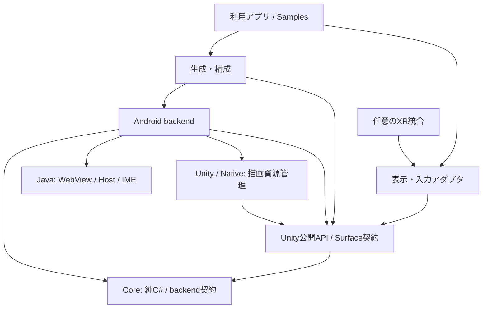

# VRWebViewのレイヤー構造案

2026-11-08 UTCの設計案。Git URLによるUPM配布と、リッチなブラウザーをSamples~へ置く方針に対する移行目標。本書の全構造が実装済みではない。preview.23で実装した上位モデルと限定した依存検査は[UpperLayers.md](UpperLayers.md)を参照。

## 設計の中心

利用者が依存するのは、ブラウザー操作、Unityの表示面、標準化した入力の契約。Android Window、IME接続、native ID、GPUの退役、特定XR SDKの詳細をアプリやサンプルへ漏らさない。

Coreへ置く基準は「Unityに依存しない」だけではなく、「ブラウザーの共通責務である」こと。純C#のGpuRetirementLedgerは描画層内部の状態処理、HostTrialTimingは検証層の処理であり、どちらも純C#という理由だけで製品Coreへ移さない。

## 論理上の責務

| 区分 | 責務 | 依存先 | 含めないもの |
|---|---|---|---|
| Application / Samples | タブ、URLバー、ブックマーク、履歴UI、配置、保存方針 | Unity公開API、表示アダプタ | JNI、native ID、IME復元、Texture破棄 |
| Presentation / Input adapters | uGUI表示、viewport/UV座標変換、標準Pointerイベント、XR入力との接続 | Unity API/契約、必要な入力SDK | ページやGPU資源の所有、独自IME制御 |
| Unity Runtime API | SessionのUnity向け窓口、借用するTextureの契約、main-threadへの通知 | Core、注入された実装契約 | Meta固有状態、URLバー、具体的なAndroid Host選択 |
| Composition | 対応プラットフォームの実装を生成し、所有者・表示面・入力を接続 | Unity API、Android実装 | ページ制御の業務ロジック、散在するSDK判定 |
| Core | Sessionの論理寿命、ナビゲーション契約、要求相関、ポインター捕捉、共通状態/エラー | .NETの基本機能 | Unity型、uGUI、XR、Android、GPU API |
| Android backend | Coreのbackend契約の実装、Javaへの要求/通知、Hostと描画サービスの寿命調整 | Core、Unity側のSurface/実行契約、内部のHost/描画実装 | UI部品、手やレイの描画、ブラウザーのタブ管理 |
| Platform internals | JavaのWebView/Host/IME/producerと、Unity/nativeの描画資源管理 | Android/Unityの各実行環境 | アプリUI、Samples、XR SDKからの直接操作 |

実装にinterfaceを一律に増やすのではなく、backend・表示面・入力の境界を優先する。HostとIMEの分離は内部責務の分離であり、任意のHost/IME/producerを自由に組み合わせられるという意味ではない。

## 主要な参照方向

以下はデータの流れではなく、コードの依存方向。



Unity公開APIは具体的なAndroid backendを生成しない。生成はCompositionへ集約し、backendはCoreとUnity側の契約を実装・利用する。これによりCore -> Androidや、Unity公開API -> Android -> Unity公開APIの循環を避ける。基本Prefabで構成済みにし、利用者が毎回接続コードを書く必要はなくす。

Java -> nativeのSurface/AHB連携などの内部呼出しは図では省略している。画素の経路はWebView producer -> AHB -> native consumer -> Unity Textureで、上記のコード依存とは別。

## 公開する契約

名前や署名はまだ確定APIではない。

- BrowserSession: ページの論理寿命、ナビゲーション、共通イベント。現在のInitialize/NavigateだけのIBrowserBackendを製品完成と扱わず、入力・ページ通知等の必要な契約を実装時に追加する。
- UnityのBrowser所有コンポーネント: Sessionを所有する窓口。ブラウザーのツールバーやXRカメラrigは所有しない。
- BrowserSurface: Texture、寸法、表示世代を借用する契約。割当て通知と実際のフレーム更新を区別し、利用側がRenderTextureをDestroy/Releaseしない。
- BrowserView: Surfaceを表示し、表示座標からブラウザー座標へ変換する。Sessionの借用者。表示を外すこととページを閉じることを同一にしない。
- 標準入力: pointer ID、Down/Move/Up/Cancel、scroll等。ピンチ認識やコントローラーの種類は入力アダプタ側で解決する。
- 編集要求/状態: IME要求の受付、失敗、未対応、観測できる状態を分ける。accepted=trueをキーボード実表示と呼ぶAPIは作らない。

既存のCore型やpublic class名を直ちに変更する案ではない。公開APIの追加・移行は、実backendへの接続と実Editor検証を伴う別変更とする。

## 所有権と実行スレッド

| 所有者 | 所有するもの | 閉じるときの契約 |
|---|---|---|
| Session所有者 | Sessionとbackendの論理寿命 | 新規操作を止め、古い要求/通知を無効化し、backendへ停止を要求 |
| Android Host | WebView、View/Window接続、producer側Surface、IME binding | UI threadの契約でproducerと編集接続を終了 |
| 描画資源所有者 | 世代ごとのRenderTextureとnative target | 表示から外れても退役完了まで保持 |
| render/retirement service | active/retiring世代の進行と解放手順 | producer停止要求とGPU完了を分け、VrAlive==0等の契約を満たして破棄へ進む |
| BrowserView / Samples | 上記の借用参照 | 参照を解除。資源所有者の代わりにTextureを破棄しない |

SessionのDisposeは論理的に使用を終了する操作で、全GPUメモリーの即時解放を意味しない。退役処理は表示GameObjectより長く生存できる。停止中も必要なrender処理を続け、callbackや破棄対象は捕捉した世代で照合する。native IDだけで現在のTextureを引き直さない。

Session寿命の世代、ナビゲーション後のdocument/request相関、GPU targetの世代を混同しない。resizeはGPU世代を変え得るが、同じページの論理Sessionを常に再作成する理由にはしない。具体的なresizeの制約はbackendの成立条件に従う。

- Core/Unity側の状態変更と通知は、一つの所有実行コンテキストへ戻す。Unity統合ではmain thread。dispatcherはイベント通知だけでなく状態変更の経路にも適用する。
- Android WebView操作はAndroid UI thread。InputConnectionは接続先のHandler等の契約に従い、全メソッドをUI threadへの同期呼出しへ一括変換しない。
- GPU操作と完了判定はUnity render thread/native backendの契約に従う。
- スレッド間の通知はsession/request/target世代に結び付ける。Unity main threadでTask.Wait/Resultにより停止待ちをしない。

## IMEとXRの境界

Android HostがWebViewの編集接続とIME要求を扱う。OpenXR/Meta側の入力許可や追跡情報は任意統合から渡す。DOM focus、View/Window focus、IME接続、Unity Application focus、OpenXR focusを一つのboolへ潰さない。

通常のpointer操作を止める判断は、必要な観測を集める入力調整部分で行い、XR SDKの値をCoreから直接読ませない。複数ページがある場合は、編集対象とIME要求をActivity単位で調整し、各Sessionが同時にfocusを奪い合わないようにする。

同一Unity Activity内の直接入力は引き続き第一候補だが未成立。代理InputConnectionは検証候補。常時前面の別Activityを標準backendにせず、旧EditText -> DOM全文同期も主方式へ戻さない。未知のIME方式を抽象interfaceの存在だけで対応済みにしない。

## パッケージとassembly

最初は一つの本体UPM内で、論理境界をassembly等で守る。レイヤー数とUPM数を一致させない。

想定assemblyはCore、Unity、Android、Bootstrap、UnityUI、Editor。Unity側のSurface契約と公開窓口を同じassemblyに置き、描画実装が参照するのはその契約。細かな描画クラスごとにassemblyを増やさない。namespace/assembly/GUIDの移動を今回行うという意味ではない。

```text
Packages/com.t34400.vrwebview/
  Runtime/
    Core/
    Unity/             # 公開窓口・Surface契約・実行調整
    Rendering/         # target所有・pump・退役の内部実装
    Android/           # C#のplatform adapter
    Bootstrap/         # backend生成と構成
    UnityUI/           # 表示とEventSystem入力
    Plugins/Android/   # ビルド済みAAR/.so
  Editor/              # 製品に必要な設定検査・build連携
  Samples~/
    Basic/
    Browser/
  Tests/
  Documentation~/
Android~/              # 製品用ライブラリのソースとbuild
Tools/
Development/           # 検証用project/module。置き場所は移行時に確定
Integrations~/         # 任意のXR統合UPMを置く場合の候補
```

Runtime/RenderingはUnity assembly配下の一部、または将来の内部assemblyとする。これはフォルダーを並べた案であり、既存native buildのsource/provenanceを壊して移す計画ではない。DevelopmentやIntegrations~の具体的配置は後で確定する。

基本の表示コンポーネントも本体で保守するなら、最初はuGUIを小さな必須依存として残す案を採る。Core/Unity API自身はuGUIを参照しない。UGUIまで完全な任意導入にしたい場合は、UnityUIを別UPMへ分ける追加判断が必要。

Input System、XR Hands、OpenXR、Meta SDKは本体から一律の必須依存にしない。標準EventSystemを使う入力経路を用意し、SDK固有アダプタは必要に応じて任意のintegration UPMへ分ける。SDK未導入でも本体をimport/compileできることを確認条件とする。ただし、QuestのIME等がSDKなしで成立すると確認したわけではなく、Quest固有の前提は検証して統合側へ明記する。

Git配布で複数UPMにする場合は、兄弟Gitパッケージの自動導入に頼らず、利用プロジェクト側で本体と必要な統合のURLを指定する導入方法を用意する。

Samples~/Browserにはタブ/URLバー/ブックマーク/履歴のUIと保存方針を置く。タブの表示切替、ページの閉鎖、バックグラウンド音声の方針はアプリ側で明示する。標準入力、IME、GPU寿命の重要処理をサンプルへコピーしない。サンプルimport後の変更は利用者側にあり、パッケージ更新で自動上書きしない。

## 検証実装の扱い

現在のHostComparison/Gpu/ActivityGpu等の比較プローブ、実験用Activity、XR Hands reset互換処理、タイマー試行と診断UIは製品Runtimeから切り離す対象。Editor assemblyも、製品設定と試験scene生成/実験用build切替を分離する。製品RuntimeやEditorが診断assemblyを参照しない構造にする。

実験用ActivityをSamples~へ移すだけではAAR内から除去されない。Android側も製品moduleと検証moduleの成果物を分け、最終AARのclasses/assets/manifestを確認する。切り分けはUnity側だけで完了したとは扱わない。

## 移行順序と確認条件

1. backend・Unity Surface・入力・所有権の契約を確定する。既存APIの実装済み範囲と追加予定を分ける。
2. 依存方向の静的チェックを用意する。CoreのUnity参照禁止、RuntimeからEditor/Diagnostics/Samplesへの参照禁止、本体のXR SDK依存禁止、assembly循環、製品AARへの検証component混入を対象にする。この全体を検査するcheckerは未完了。Core/Presentation/Browser.Sampleに限定した実装はUpperLayers.mdを参照。
3. 実Editorで現行のimport/compileを確認し、backendと描画資源所有者を接続する。GpuRetirementLedgerの合成テストを実GPU完了の代用にしない。
4. 表示・入力アダプタと最小Basic sampleを製品経路へ接続する。IME成立条件は別途Questで判断する。
5. 製品/検証のC#/Android成果物と依存を分離し、Runtime/Editorのimport、IL2CPP/Android build、nativeロード、GUID・シーン互換を確認する。
6. Browser sampleと任意XR統合を追加し、空のconsumer projectからGit URLで導入する。開発projectへ偶然入っているpackageに依存しないことを確認する。

この設計によってIMEや製品backendが完成したとは扱わない。まず境界と確認項目を決めるための提案。
